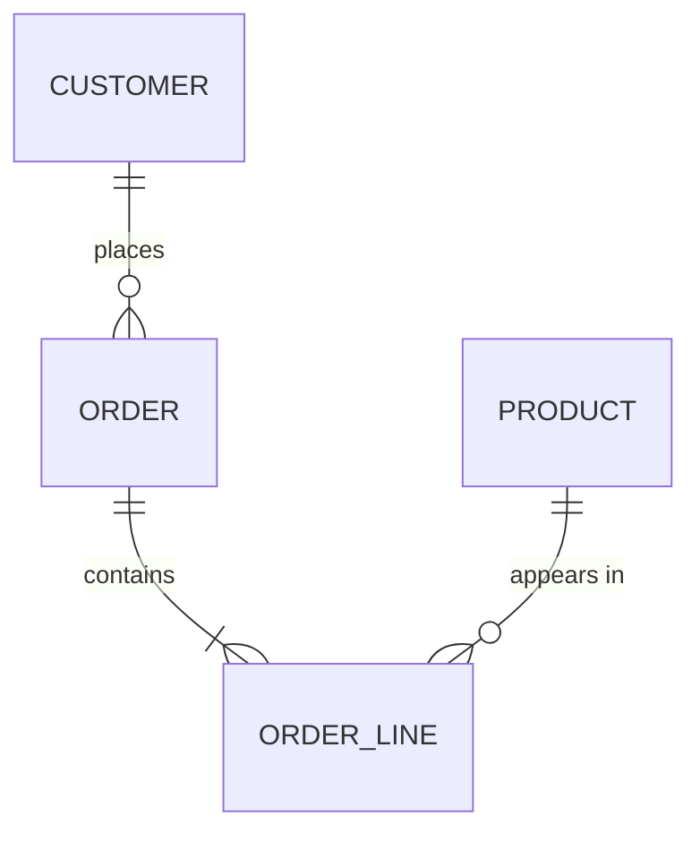

# Conceptual and logical ER modeling

## Three levels
| Level | Audience | Contents |
|---|---|---|
| Conceptual | Business stakeholders | Entities, relationships, key business rules; no attributes beyond identifiers |
| Logical | Analysts, designers | All attributes, keys, cardinality/optionality, normalised to 3NF; DBMS-independent |
| Physical | DBAs, developers | Tables, types, indexes, partitions, constraints for a specific engine |

## Running the conceptual session (Hernandez-style)
1. Interview users; collect nouns (candidate entities) and verbs (relationships) from forms, reports, and process descriptions.
2. For each relationship ask two questions both ways: "Can a customer have more than one order?" (cardinality) and "Must every order have a customer?" (optionality).
3. Record business rules as you go ("an order needs at least one line", "a product may be discontinued but stays on old invoices").

## Notation (crow's foot)

`||` exactly one, `o|` zero or one, `|{` one or many, `o{` zero or many.

## Logical model steps
- Attributes per entity, each atomic (1NF); identify candidate keys.
- Resolve many-to-many into associative entities (ORDER_LINE).
- Normalise to 3NF; record deliberate denormalisation as a physical decision later.
- Attribute specifications: domain, allowed values, nullability, default, source.
- Subtypes/supertypes (party → person/organisation): choose single table, table per type, or table per concrete class at physical level.

## Physical mapping
- Entity → table; identifier → PK (surrogate or natural) + UNIQUE alternates.
- Relationship 1:N → FK on the N side with NOT NULL if mandatory; 1:1 → FK with UNIQUE; M:N → junction table.
- Business rules → CHECK, FK actions, triggers, or application logic (documented).

## Tooling
Diagram as code keeps models versioned: DBML (dbdiagram.io), Mermaid `erDiagram`, PlantUML; reverse-engineer existing databases with SchemaSpy, DBeaver ER diagrams, `pg_dump -s` into dbdiagram imports.

## Verify
Walk the diagram with business users using concrete examples (one real customer's orders); every report requirement can be answered by a query path through the model.
