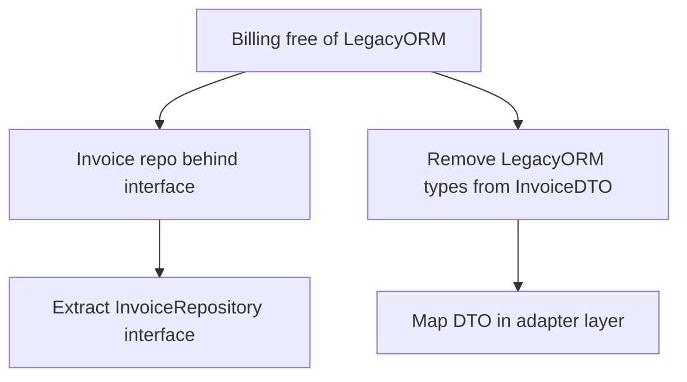

# The Mikado method

From Ellnestam and Brolund, *The Mikado Method*. A way to do a big change (upgrade a framework, split a module, replace a dependency) in small, always-green steps without a long-lived branch.

## The loop
1. **Write the goal** at the top of a graph (paper, whiteboard, or a Markdown/Mermaid file): "Billing module has no dependency on legacy ORM".
2. **Try it naively** - make the change the simplest way, directly.
3. **Look at what breaks** (compile errors, failing tests). Each distinct thing you need to fix first becomes a **prerequisite** node with an arrow from the goal.
4. **Revert everything**: `git reset --hard` / `git restore .`. This is the step people skip; do not keep the broken attempt.
5. Pick a **leaf** prerequisite (no prerequisites of its own) and try it naively. If it breaks things, add its prerequisites to the graph and revert again.
6. When a leaf can be done with everything green, **commit it** (to main, small and safe), tick it off the graph.
7. Repeat until the goal itself is a leaf; do it, commit.

## Why revert
Each attempt is an experiment that discovers dependencies. Keeping half-broken changes leads to a "big ball of red" you cannot ship. Reverting keeps the codebase releasable, and each committed step is small enough to review and merge daily.

## Practical tips
- Time-box each attempt (10-15 minutes). If it is still red after that, revert and decompose.
- Keep the graph in the repo or the ticket so others can pick up leaves in parallel.
- Combine with branch by abstraction or feature flags for prerequisites that change behaviour.
- Use the compiler and tests as the discovery tools; automated refactorings (IDE) make leaf steps quick.

## Verify
- [ ] Every commit on main during the effort is green and deployable.
- [ ] The graph is fully ticked; the goal commit is small because all prerequisites were done.
