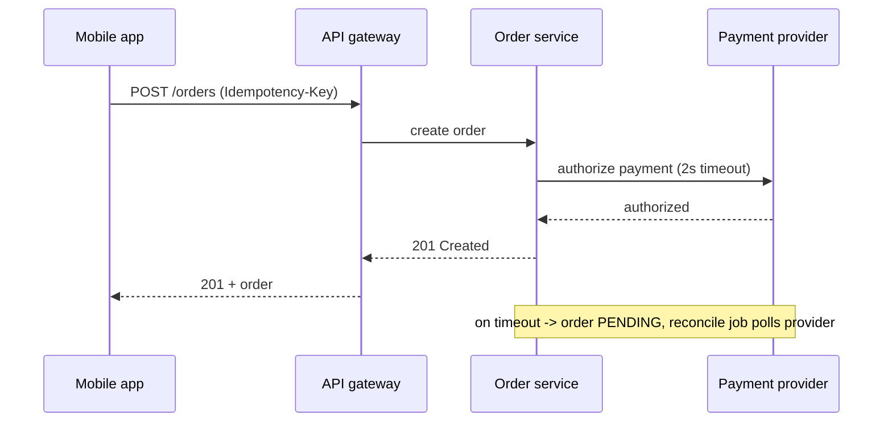

# Deployment and runtime views

## Runtime view (arc42 section 6)
Shows how building blocks collaborate in a few **important scenarios**: the main user journey,
startup, error/failover paths, a tricky integration. 3-6 scenarios, not every use case.

Include timeouts, async hops (queues), and failure branches; that's where reviewers find bugs.

## Deployment view (arc42 section 7, C4 deployment diagram)
Maps software to infrastructure:
- Environments (prod, staging), regions/AZs, clusters, nodes or managed services.
- Which containers/services run where, replica counts and autoscaling bounds.
- Network zones, ingress/egress, load balancers, firewalls, private links.
- Data stores with replication and backup locations (data residency questions live here).
- Level 1 overview + level 2 details per environment if they differ.

Diagram-as-code: Structurizr DSL `deploymentEnvironment "Production" { deploymentNode "eu-west-1" {...} }`,
or Mermaid/PlantUML; generate infra parts from Terraform state where possible (inframap, Cloudcraft).

## Keep them true
- Store with the code; review in PRs that change infra or main flows.
- Each diagram has a title, key/legend, and date or version.
- Note what the view deliberately omits.
