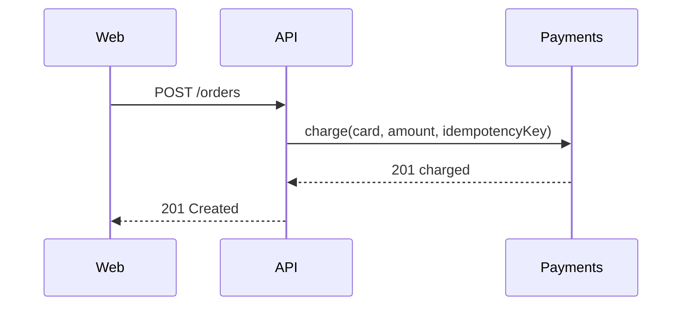

# Diagrams as code (Structurizr, Mermaid, PlantUML)

Text-defined diagrams live in the repo, diff in pull requests, and regenerate on every build - so they get updated with the code.

## Tool choice
| Tool | Strength | Weakness |
|---|---|---|
| Structurizr DSL | Model-based: define elements once, generate many C4 views; consistent naming | Needs Structurizr Lite/CLI to render; C4-specific |
| Mermaid | Renders natively in GitHub/GitLab Markdown, Notion, many docs tools | Layout control limited; C4 support is experimental |
| PlantUML (+ C4-PlantUML) | Mature, many diagram types (sequence, deployment, state) | Java/Graphviz rendering dependency |
| D2 | Good auto-layout, modern syntax | Smaller ecosystem |

## Structurizr DSL: one model, many views
```
workspace "Shop" {
  model {
    customer = person "Customer"
    shop = softwareSystem "Shop" {
      web = container "Web App" "Next.js"
      api = container "API" "Kotlin, Spring Boot"
      db  = container "Database" "PostgreSQL" { tags "Database" }
    }
    payments = softwareSystem "Payment Provider" { tags "External" }
    customer -> web "Browses and orders using"
    web -> api "Calls" "JSON/HTTPS"
    api -> db "Reads/writes" "JDBC"
    api -> payments "Charges cards via" "HTTPS"
  }
  views {
    systemContext shop { include * autolayout lr }
    container shop { include * autolayout lr }
    styles { element "Database" { shape cylinder } }
  }
}
```
Run: `docker run -it --rm -p 8080:8080 -v $PWD:/usr/local/structurizr structurizr/lite`; export in CI with `structurizr-cli export -workspace workspace.dsl -format plantuml|mermaid|png`.

## Mermaid sequence for a runtime view


## Practice
- Keep diagrams in `docs/architecture/`; render in CI (mermaid-cli `mmdc`, `plantuml -tsvg`, structurizr-cli) and publish with the docs site; fail the build on syntax errors.
- Pin renderer versions; layout changes between versions create noisy diffs in committed images (or do not commit rendered images at all).
- Drift detection: generate component views from code where possible (Structurizr component finder, ArchUnit, dependency-cruiser `--output-type dot`) and compare with the hand-written model.

## Verify
- [ ] Diagram source changes appear in the same PR as the architecture change.
- [ ] CI renders all diagrams without errors.
