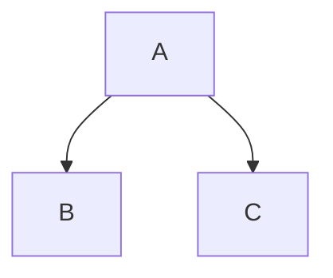

Install `@docusaurus/theme-mermaid`, add it to `themes`, and set `markdown.mermaid` to `true`:

```js title="docusaurus.config.js"
export default {
  markdown: {mermaid: true},
  themes: ['@docusaurus/theme-mermaid'],
};
```

Use a code block with language `mermaid`:

````md

````

Theme per color mode, and options passed straight to `mermaid.initialize`:

```js
themeConfig: {
  mermaid: {
    theme: {light: 'neutral', dark: 'forest'},
    options: {maxTextSize: 50},
  },
},
```

Dynamic diagrams use the component:

```mdx
import Mermaid from '@theme/Mermaid';

<Mermaid value={`graph TD; A-->B;`} />
```

Layouts: the bundled `elk` engine is the default for supported diagram types; `dagre` is also bundled. Site-wide:

```js
mermaid: {options: {layout: 'dagre'}},
```

Per diagram, via Mermaid front matter (overrides the site setting; `layout: elk` selects ELK explicitly):

````md
```mermaid
---
config:
  layout: dagre
---
graph TD;
```
````

## Checked

2026-11-04. Read in full against the Docusaurus Diagrams page (markdown-features-diagrams.mdx): install and enable steps, mermaid code block, light/dark theme keys, mermaid.options passed to mermaid.initialize, Mermaid component, elk default and dagre layouts (site-wide and per-diagram front matter) all match. Nothing removed.

Method: documentation only; no commands were run.
