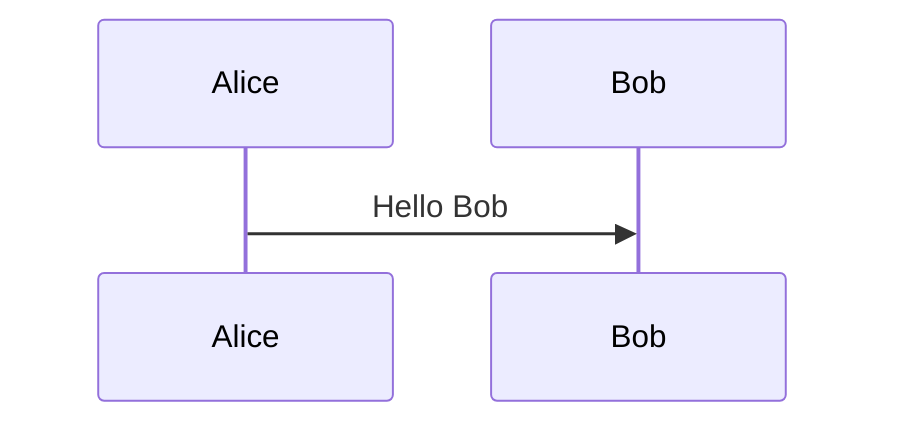

Hugo natively supports GoAT ASCII diagrams through an embedded code block render hook; use a fenced block with the `goat` language. GoAT lives at github.com/bep/goat.

Hugo has no built-in Mermaid template. Create a code block render hook at `layouts/_markup/render-codeblock-mermaid.html`:

```go-html-template
<pre class="mermaid">
  {{ .Inner | htmlEscape | safeHTML }}
</pre>
{{ .Page.Store.Set "hasMermaid" true }}
```

Load the Mermaid script at the bottom of the base template, before the closing `body` tag. It runs only when a page set `hasMermaid`:

```go-html-template
{{ if .Store.Get "hasMermaid" }}
  <script type="module">
    import mermaid from 'https://cdn.jsdelivr.net/npm/mermaid/dist/mermaid.esm.min.mjs';
    mermaid.initialize({ startOnLoad: true });
  </script>
{{ end }}
```

Then write a fenced block with the `mermaid` language:

````md

````

## Checked

2026-11-04: GoAT support through an embedded code block render hook, the missing built-in Mermaid template, render hook path and content, hasMermaid store flag, conditional module script and mermaid fence confirmed against the Hugo docs Diagrams page. Nothing removed.

Method: documentation only; no commands were run.
